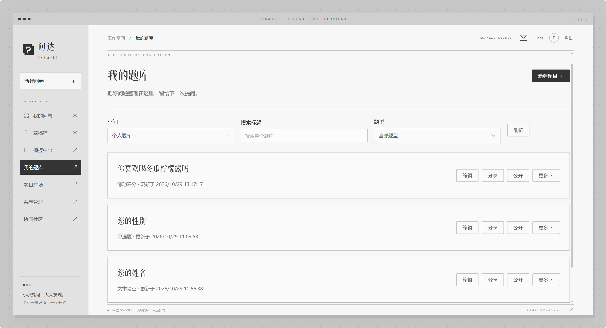
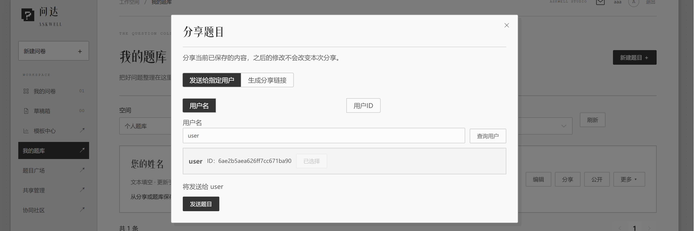
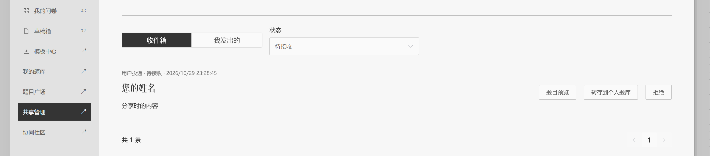
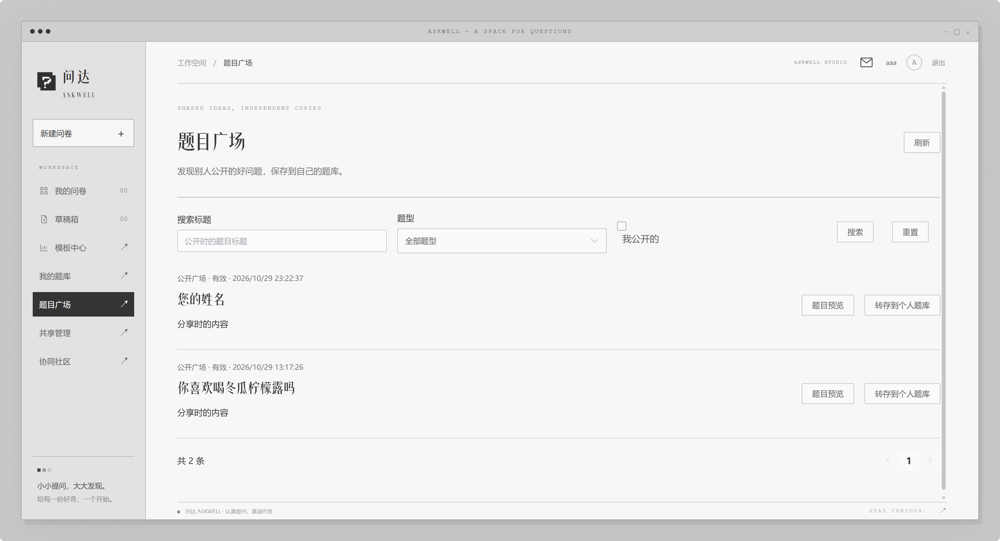
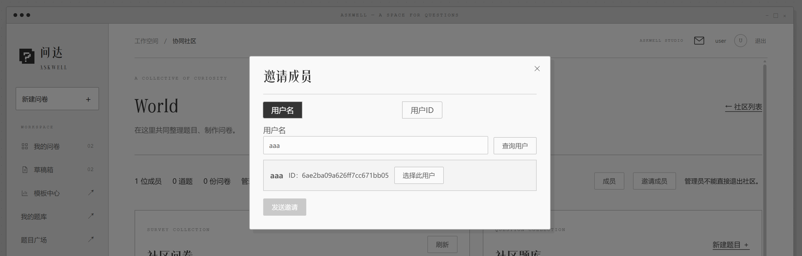
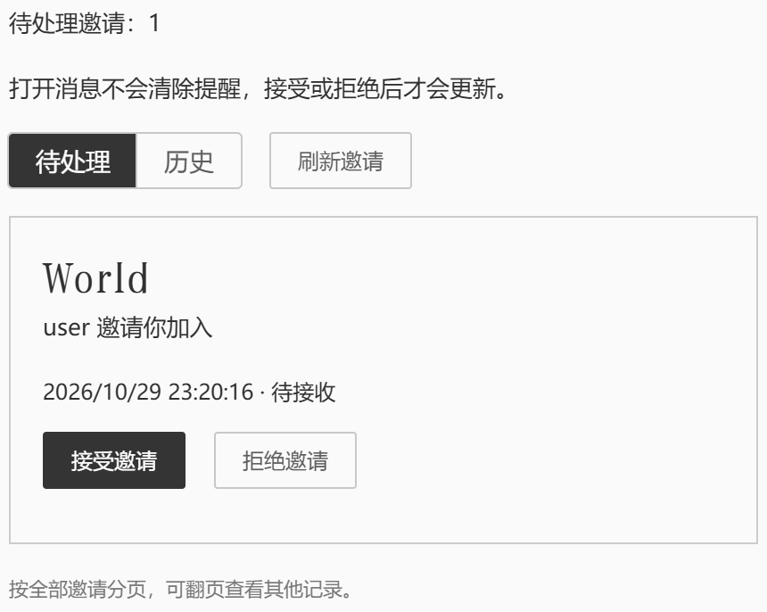
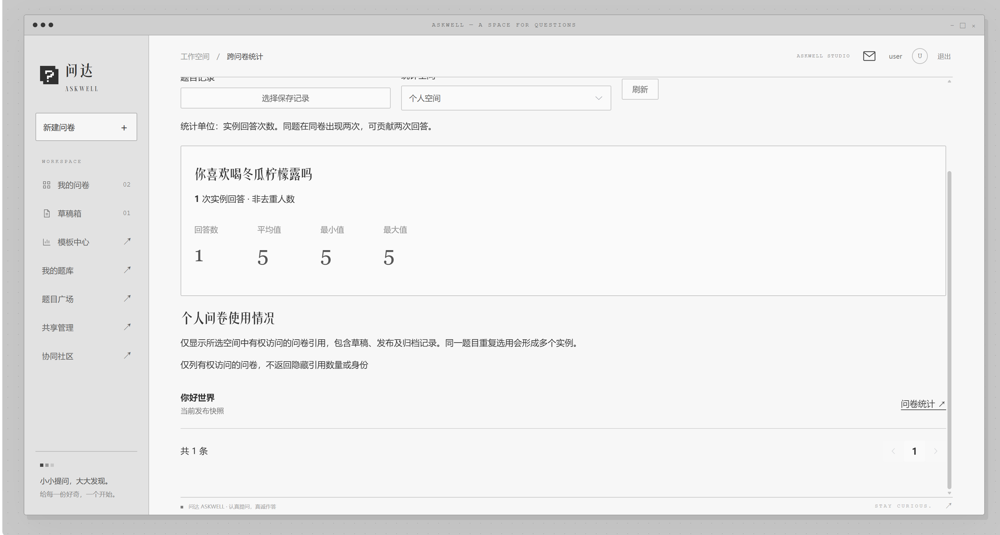

姓名：李昕芮  
学号：10243330406  
GitHub仓库链接： https://github.com/water0417/CMS_PJ1_2.git  
项目：问达·ASKWELL  
阶段：第二阶段  
报告日期：2026年10月29日

# 一、项目目标

第二阶段根据题目复用、共享和版本管理的新需求，在第一阶段在线问卷系统上进行增量扩展。第一阶段的题目主要保存在各问卷内部，适合独立设计与填写，但难以重复选用、追溯修改历史，也无法按同一道题汇总不同问卷的回答。

本阶段保留第一阶段的账号、九种题型、跳转与循环、答案校验、事务提交和统计功能，将题目扩展为可独立保存的资源，支持个人题库、指定用户投递、链接分享、公开题目广场及协同社区。题目每次修改保留历史，问卷选用明确版本，草稿由用户主动更新，已发布问卷与历史答卷保持原有内容。同时增加按题目、版本和授权空间进行的跨问卷统计。

# 二、系统设计

## 2.1 使用场景与设计边界

系统使用者可以同时承担问卷创建者、填写者、题目作者、题目接收者和社区成员等角色。角色由资源归属与成员关系决定，不要求注册不同类型的账号。

| 使用场景 | 第二阶段处理方式 |
| --- | --- |
| 经常重复创建相似题目 | 独立保存到题库，新问卷从题库选择 |
| 将题目提供给其他用户 | 按用户投递、生成分享链接或公开到广场 |
| 修改题目但不影响旧问卷 | 修改生成新版本，问卷固定引用原版本 |
| 找回旧内容并查看修改关系 | 保存历史与来源，恢复时形成新的最新版本 |
| 同一题目用于不同问卷 | 分别选用指定版本，每次建立独立问卷实例 |
| 查询题目使用和回答情况 | 按版本及个人／社区空间查询引用与统计 |
| 多人共同维护题目 | 邀请加入社区，共同维护社区题库 |

社区允许当前成员提交修改，但不提供实时多人共同编辑，并发保存通过版本检查处理。

## 2.2 系统架构

继续采用浏览器、后端API和数据库三层架构：

```text
浏览器：Vue 3 + TypeScript + Element Plus
                  │ HTTP / JSON / Cookie
后端：NestJS + TypeScript
                  │ Mongoose
数据库：MongoDB副本集
```

开发时由Vite代理API请求，构建后由后端统一提供页面和接口。第二阶段复用第一阶段的工程和Git历史，增加业务模块而非替换原系统。

| 层次 | 本阶段职责及对应实现 |
| --- | --- |
| HTTP接口层 | 原接口继续保留，`library-api.ts`增加题库、共享、社区和跨问卷统计接口 |
| 业务与权限层 | `library.ts`管理题目、版本和共享，`communities.ts`管理社区，`access.ts`集中检查权限与事务条件 |
| 领域规则层 | `domain.ts`继续执行九题型校验、跳转和路径重算，新增可选题目来源类型 |
| 数据层 | 原模型保留，`phase2-models.ts`增加题目、版本、共享与社区模型 |
| 统计层 | `library-statistics.ts`按固定版本和授权空间执行MongoDB聚合 |

## 2.3 业务框架

| 模块 | 主要功能 | 关键边界 |
| --- | --- | --- |
| 原问卷系统 | 创建、编辑、发布、填写、提交及整卷统计 | 原有功能继续可用 |
| 个人题库 | 九题型保存、搜索、筛选、编辑、另存 | 题目归个人所有，修改保留历史 |
| 历史管理 | 查看、预览、恢复及追溯来源 | 恢复不覆盖旧历史 |
| 分享与广场 | 用户投递、链接、公开、转存和撤回 | 分享固定内容，转存形成独立副本 |
| 协同社区 | 邀请、题库、问卷、成员与退出 | 依据当前成员身份授权 |
| 问卷题库操作 | 选用、保存入库、升级及脱离 | 实例身份稳定，已发布内容不变 |
| 使用查询与统计 | 题目引用、跨问卷九题型统计 | 版本、资源和空间分别隔离 |

主要流程为：创建题目→保存题库→选用或共享→建立问卷实例→发布填写→按问卷或题目查看统计。题目发生修改后，引用旧题目的问卷不自动更新，仅未发布草稿可由有管理权限的用户选择更新，已发布问卷保持不变。

## 2.4 相关设置

### 2.4.1 问卷状态与归属

草稿、已发布、已关闭三种状态延续第一阶段设计。草稿可编辑与升级题目；发布后固定题目和规则，可以设置截止时间、关闭及查看结果；关闭后拒绝新提交。删除采用保留数据的软删除方式，相关查询按现有规则过滤。

问卷创建时选择个人或社区空间，之后不能通过修改草稿内容伪造归属。个人问卷使用社区题目，也不会自动成为社区问卷。

| 操作          | 个人问卷 | 社区问卷           |
| ----------- | ---- | -------------- |
| 编辑、发布、关闭等管理 | 创建者  | 仍为成员的创建者或社区管理员 |
| 查看统计和填写内容   | 创建者  | 当前社区成员         |


### 2.4.2 题目与历史

延续九种题型：单选、多选、文本、数字、矩阵单选、完整排序、时间、滑动评分、色彩。

题库新建形成第一份内容记录，“保存修改”生成原题的新历史，“另存为新题目”则使用当前输入建立独立题目并记录来源。恢复旧内容也生成新记录，不改写中间历史。

题库卡片提供编辑、分享、公开等常用操作，详情页面可查看历史、预览、使用情况和统计。新建或保存后返回来源题库，默认页面不展示内部ID和乐观锁字段。历史记录用自然语言说明修改与恢复关系，副本来源仅在有权限时显示可读内容。

### 2.4.3 分享与公开

| 方式 | 使用过程 |
| --- | --- |
| 指定用户投递 | 用完整用户名或用户ID查找并确认接收者，对方选择接受或拒绝 |
| 分享链接 | 用户登录后打开链接，预览并保存到个人题库 |
| 公开广场 | 作者主动公开，其他用户按标题和题型检索、预览及转存 |

三种方式均固定具体题目版本，作者后续修改不会改变已发出的内容。重复接受同一共享返回原有副本，撤回阻止后续读取与接收，不删除已经转存的副本。发送历史保留状态及撤回记录，便于管理。

“分享”与“公开”使用不同入口，避免将定向发送误操作为全体可见。社区题对外共享前需主动保存个人副本。

### 2.4.4 协同社区与邀请

社区具有共享题库和社区问卷。当前成员均可新增题目、保存修改和恢复历史；两人同时编辑同一记录时，只允许一个提交成功，另一方保留输入并比较最新内容。

管理员邀请或移除成员。退出或被移除后，用户失去社区题库、问卷及统计权限；离开前主动保存的个人副本仍可用，系统不自动归档整个社区题库。

社区页面展示真实概览及题目、问卷和成员入口。顶部信封显示待处理邀请，深红色感叹号表示仍有邀请未处理，打开面板不清除数量，接受或拒绝后更新。请求失败展示未知状态与重试，不将错误伪装成没有邀请。

# 三、MongoDB设计

## 3.1 设计目标与方法

本阶段保留MongoDB为唯一业务数据库，在原有嵌入式问卷定义上增加题目资源和版本引用。题库管理可复用资源，问卷保存固定内容，不自动同步。

需要解决的重点包括题目身份、历史与派生关系、跨问卷引用、共享幂等、社区退出竞态，以及统计空间隔离。

## 3.2 数据需求与主要访问模式

| 操作 | 访问方式与设计影响 |
| --- | --- |
| 查询个人／社区题库 | 按所属空间、题型和标题查询，分页返回 |
| 查看及恢复历史 | 按题目ID读取版本，新修改记录与最新指针协调更新 |
| 接受题目共享 | 校验固定版本，事务建立独立副本和接收记录 |
| 编辑问卷引用 | 同时检查来源、固定内容、问卷权限和revision |
| 成员退出或移除 | 更新成员状态，并与成员依赖写操作协调 |
| 查询使用情况 | 根据固定来源匹配草稿与发布快照，先过滤空间再分页 |
| 跨问卷统计 | 连接正式答卷、授权问卷和固定版本中的题目实例 |
| 广场检索 | 按公开时的固定标题及题型过滤，不读取原题后来修改的标题 |

## 3.3 集合结构

第一阶段的`users`、`surveys`、`survey_versions`、`response_attempts`、`responses`、`submission_claims`、`sessions`、`auth_throttles`八个集合保留，新增七个集合，共十五个。

| 新增集合 | 主要字段 | 作用 |
| --- | --- | --- |
| `library_questions` | `scopeKey`、`ownerId`或`communityId`、`latestVersionId`、`revision`、`title`、`type`、`provenance` | 独立题目身份、归属与最新指针 |
| `question_versions` | `questionId`、`number`、`content`、`parentVersionId`、`restoredFromVersionId`、`authorId` | 保存不可变内容及修改关系 |
| `question_shares` | `kind`、`questionId`、`versionId`、`senderId`、`recipientId`或`token`、`status` | 固定版本投递、链接与公开 |
| `question_share_copies` | `shareId`、`userId`、`questionId`、`versionId`、`initialQuestion` | 接收幂等及首次结果回放 |
| `communities` | `name`、`adminId`、`revision`、`writeSerial` | 社区及成员依赖操作的并发协调 |
| `community_memberships` | `communityId`、`userId`、`role`、`active` | 成员关系与当前权限 |
| `community_invitations` | `communityId`、`senderId`、`recipientId`、`status`、`revision` | 邀请及处理状态 |

`users._id`继续作为用户ID，规范化用户名仍唯一。个人或社区题库由`scopeKey`及归属关系组织，不为每个用户或社区新建物理集合。公开广场是有效公开分享的查询视图，不复制整个题库。

### 3.3.1 题目、版本与问卷实例

本阶段明确区分三个身份：

| 身份 | 含义 |
| --- | --- |
| 题目资源ID | 标识一道独立可复用的题目 |
| 题目版本ID | 标识该题某一次固定内容 |
| 问卷实例ID | 标识该题在一份问卷中的具体出现位置，用于答案与跳转 |

题库版本`content`仅保存题型、标题、说明、必答、选项、矩阵行和校验七类字段，不携带问卷实例ID及跨题跳转。

问卷继续嵌入完整题目内容，新增可选`source={questionId,versionId}`。每次选题生成新的实例ID，即使同一来源在同一问卷出现多次，也分别保存答案。发布快照同时固定内容与来源，填写不跟随题库最新指针。

题目资源中的标题和题型用于列表查询，是有意保留的少量冗余；新版本与最新摘要在事务中一起更新。历史版本保存完整内容，便于恢复和准确解释旧题。广场检索读取共享固定版本，避免最新版摘要改变旧公开项含义。

### 3.3.2 版本、来源与答案

`question_versions.number`表示单题内容历史；`revision`用于并发控制；`dataVersion`与`contentSchemaVersion`表示结构版本。原问卷发布版本、`schemaVersion`和`routingMode`继续承担各自职责，不混用。

副本和另存产生独立资源，`provenance`只记录来源，不自动更新，也不把副本答案归入原题统计。恢复形成新版本，并记录恢复来源。

答案编码延续第一阶段：

| 题型 | `answers[实例ID]`的值结构 |
| --- | --- |
| 单选／文本 | 选项ID字符串／文本字符串 |
| 多选／排序 | 选项ID数组，排序数组顺序表示名次 |
| 数字／评分 | 数值 |
| 矩阵单选 | 行ID到选项ID的对象 |
| 时间 | 日期、时刻或规范UTC日期时间字符串，由题目模式确定 |
| 色彩 | 六位十六进制颜色字符串 |

填写状态、有效路径、确认记录和候选答案机制保留，不将未完成过程混入正式答卷。

## 3.4 索引与一致性

新增索引围绕题库空间、版本历史、共享与成员查询设置。题目与版本号的组合唯一索引防止重复版本；共享与接收者组合唯一索引保证重复接受不生成多个副本；社区与用户组合唯一索引保证成员关系唯一。题库空间与更新时间、发送者与创建时间等索引支持列表；原唯一索引和TTL机制继续使用。

题目修改与恢复在事务中匹配`revision`、插入新版本并更新最新指针，冲突返回409。共享接收与撤回写同一共享记录，使并发行为具有明确顺序。成员退出、移除和依赖成员权限的写操作在事务中共同更新社区`writeSerial`；发生冲突后重新检查成员，避免退出后沿用旧权限继续写入。

MongoDB结构验证检查基础类型、归属和必要字段，领域及服务层检查内容、引用与跨文档约束。历史版本不可变由受控后端接口保证，不表示数据库管理员无法直接修改数据。

## 3.5 安全与设计决策

延续随机盐密码哈希、令牌哈希与Cookie会话。作者、发送者和操作用户由会话确定，不信任客户端指定身份。用户名与ID查询仅返回必要的账号展示信息。

读取共享内容不授予原题编辑权；转存来源不授予原作者读取对方问卷和答卷的权限。社区身份每次由后端检查，未接受邀请不算成员。分享链接需要随机令牌，不能只凭共享记录ID转存。

使用情况和统计明确区分个人与社区空间，数据库先过滤再计数分页。社区成员可以查看社区问卷中已使用的私人来源固定版本统计，但不能因此浏览私人题库或其他版本。匿名提交与账号限次保留第一阶段的隔离机制。

## 3.6 为什么不采用关系数据库结构

关系数据库能够实现版本、共享和成员关系，但九种题型具有不同的配置与答案结构。若完全拆分为关联表，需要额外组织题目、选项、矩阵行和不同校验字段。无论采用何种数据库，问卷直接读取最新版题目都会影响历史稳定，因此仍需固定版本或快照。

本项目根据课程要求和访问方式，保留嵌入式问卷快照，并将独立增长的题目历史、共享和成员数据分离。不是排斥实体关系分析，而是不机械地把文档模型实现为大量关联表。

## 3.7 为什么适合MongoDB

MongoDB的对象和数组适合表达题目内容及异构答案，独立集合适合保存不断增长的版本与共享记录。嵌入和引用结合，保证填写时整体读取固定内容，支持独立题目管理和使用追溯。

集合验证、唯一索引、聚合和多文档事务分别支持结构约束、并发防重、跨问卷统计及一致提交。题库和广场列表采用分页，包含题目标题搜索功能。

# 四、跳转设计

整体沿用第一阶段的条件跳转、专属分支、返回和200次循环限制，未重新设计跳转逻辑。

新增调整主要针对题库复用：题库只保存题目内容，跨题跳转由问卷单独配置。每次选题生成独立的问卷实例ID，跳转引用实例而非题库资源，避免同一道题被多问卷使用时相互影响。

题目更新保留实例ID与原跳转规则，并重新校验完整问卷。若新版删除了规则引用的选项，系统拒绝升级并提示修正，不自动删除规则。已发布问卷继续使用原快照，不受题库修改影响。

# 五、校验设计

第二阶段保留第一阶段的九题型答案校验、发布校验和最终路径检查，新增以下约束：

|新增校验|主要内容|
|---|---|
|版本与来源|题目和版本必须匹配，引用内容须与固定版本一致，禁止伪造来源|
|升级与脱离|仅允许修改草稿，升级须通过完整规则校验，脱离来源必须明确执行|
|共享|检查接收者、链接令牌和共享状态，重复接受不产生重复副本|
|社区权限|按当前成员身份授权，退出后不能沿用旧权限或旧邀请|
|查询与统计|检查资源、版本和空间范围，先过滤再计数分页|
|并发修改|检查`revision`，冲突时保留输入并提示比较，禁止静默覆盖|

上述校验由前端提示、后端业务规则和MongoDB结构约束共同完成。
# 六、第二阶段新增重点
本阶段的重点不是增加题型，而是将第一阶段独立的问卷编辑流程扩展为**可复用、可追溯、可共享的题目管理体系**。
## 6.1 三层身份与嵌入引用结合

区分题目资源、题目版本和问卷实例三个身份：资源用于复用，版本用于固定内容，实例用于填写和跳转。问卷保留嵌入快照，同时记录来源，兼顾独立管理与历史稳定，避免推倒第一阶段结构。

## 6.2 修改、恢复与独立副本分离

修改原题产生新版本，恢复历史也生成新记录；接收共享或另存则形成独立题目。来源关系用于追溯，不自动同步修改，也不自动合并统计，避免一个人的修改影响其他用户或旧问卷。

## 6.3 面向协同的权限与并发控制

将个人题库扩展为邀请制社区，区分共同改题、问卷管理和统计查看权限。成员退出与依赖成员身份的写操作通过事务协调，防止权限检查后被移除却仍继续写入；多人同时改题时通过版本冲突保留各自输入。

## 6.4 按版本与空间进行跨问卷统计

统计从“某份问卷的一道题”扩展为“某个题目版本在授权空间中的回答”。个人、社区、不同版本和独立副本分别隔离，并明确以实例回答次数为单位，避免混合不同题意或泄露他人数据。

## 6.5 根据使用反馈简化交互

保留后台历史能力，将技术字段收进次级入口；题库使用卡片和编辑、分享、公开等明确操作，增加用户名查询、社区概览及邀请信封。将数据保护机制转化为用户容易理解的操作，而不是直接展示后端结构。
# 七、AI使用过程

## 7.1 AI使用日志

本阶段使用Codex辅助分析、实现、测试和文档整理。以下为实际对话的需求摘要，不作为逐字提示词记录。

| 提示词摘要                                                                                                                                                                                                                                                                                                | AI产出               | 修改                          |
| ------------------------------------------------------------------------------------------------------------------------------------------------------------------------------------------------------------------------------------------------------------------------------------------------------ | -------------------- | --------------------------- |
| 目前要进入到第二阶段，仓库链接更新到[https://github.com/water0417/CMS_PJ1_2.git](https://github.com/water0417/CMS_PJ1_2.git)  <br>仓库变更非常重要，目前这个仓库是空的，之后提到仓库的时候都请使用新仓库链接，比如说写后端提示词、push等操作  <br>请根据需求变更里面的内容，结合之前的整个系统内容，梳理一下第二阶段要如何开展，对于需要设计决策的地方，请先向我询问意见，再进行下一步                                                        | 新旧需求对照、身份与版本划分、兼容方案  | 针对方案提出要求修改和决策               |
| 题目既可以按照用户id直接投递（用户名的话是否容易重复，不过好像之前没有设计用户id字段，现在还能加进去吗），投递之后，接收方选择是否接受转存到题目库，又可以生成题目链接，某个用户点击题目链接之后可以转存到自己的题库，并且设计一个公开题目库，如果有用户希望自己的题目被公开给大家使用，可以直接投放到题目广场。不过不允许多人直接修改覆盖一个题目，他可以修改自己题目库里面的题目（别人共享给他的题目也可以），但是修改之后希望共享给别人的话需要再次共享，而不会直接覆盖掉原来共享者题目库里面的题目。除此之外，有条件的话可以做协同题目库（后续的协同社区），所有参与者都可以任意修改提交里面的题目。 | 题目版本、共享和接收幂等模型及接口    | 选择共享固定内容，接收者独立持有，修改后需重新分享   |
| 社区功能也在第二阶段完成                                                                                                                                                                                                                                                                                           | 社区、邀请、成员及问卷权限实现      | 确定成员可共同改题和查看统计，管理问卷限创建者或管理员 |
| 每个题目新建了之后就直接返回我的题库，而不是还停留在这个版本，版本页面我觉得很冗杂，如果要生成新题目就直接在我的题库里面找到就题目然后编辑、另存就好了                                                                                                                                                                                                                            | 精简编辑页、保存后返回来源题库、保存修改与编辑另存分离   | 要求新建后返回题库，区分保存修改与另存，减少默认版本信息 |
| 社区的地方前端需要设计一下社区的页面，而不是一个单调的名字，用户根本看不懂，然后收到的邀请直接设计为一个信封图标放在页面里面，如果有新消息就出现感叹号（深红色低饱和）                                                                                                                                                                                                                    | 补充查询接口、概览、提醒与精简交互    | 确定用户名及ID双方式、可读社区信息、低饱和深红提醒  |
| 社区页面点击题库或者问卷之后不应该跳转到个人题库和问卷，这是隔离开的                                                                                                                                                                                                                                                                     | 空间过滤和分页专项回归          | 要求个人与社区列表严格隔离，不能前端过滤伪造分页    |
| 公开题库加上检索功能，以及题目类型筛选                                                                                                                                                                                                                                                                                    | 固定版本检索、服务版本诊断、轮询故障处理 | 提出标题检索与题型筛选，并反馈社区接口报错 |

## 7.2 AI使用说明

AI主要完成集合与接口设计、前后端代码、自动测试、独立环境浏览器检查和技术文档。本人负责解释新需求、选择业务边界，并根据页面使用反馈推动方案调整。具体工程实现不表述为本人独立手工编写。

本阶段的关键个人决策包括独立转存而非自动同步、社区纳入必做、恢复生成新版、退出后的副本边界、统计按空间和版本隔离，以及隐藏技术术语、区分分享与公开等交互调整。

生成结果并非一次正确。联调发现过空间查询口径不一致、旧进程未加载新路由、定时器调用异常和窄屏控件挤压，经过真实请求、构建和测试修正。

# 八、测试结果

## 8.1 自动化测试

测试以现有规则脚本、API与真实MongoDB集成脚本为主，使用独立测试数据库，不改写正式问卷。以下依据截至2026年10月29日已保存的执行记录整理，本次报告编写没有重新运行测试。

| 测试类别            | 命令                                   | 已记录结果          |
| --------------- | ------------------------------------ | -------------- |
| 规则与前端逻辑单元       | `npm.cmd test`                       | 62/62项通过       |
| 第一阶段API回归       | `npm.cmd run test:integration`       | 28/28组通过       |
| 第二阶段核心API       | `npm.cmd run test:phase2`            | 24/24组通过       |
| 使用情况空间隔离专项      | `npm.cmd run test:usage-scope`       | 9/9组通过         |
| 用户查询、邀请、另存与概览专项 | `npm.cmd run test:backend-additions` | 9/9组通过         |
| 广场检索专项          | `npm.cmd run test:square`            | 7/7组通过         |
| 类型检查与完整构建       | `npm.cmd run build`                  | 通过，保留已有依赖包体积提示 |

各项是独立脚本及场景分组，组内含多条断言；不将API组数、单元项数和浏览器检查数相加作为测试总数。最新仅改前端的轮次重新构建并通过62项单元测试，数据库结论引用此前明确执行的专项与回归记录。

| 覆盖内容 | 主要验证结果 |
| --- | --- |
| 复用与版本 | 九题型保存、实例ID隔离、历史恢复及固定快照正确 |
| 并发与共享 | 同revision仅一人成功，接受幂等，撤回不删除副本 |
| 来源与升级 | 伪造引用被拒绝，另存保留当前内容，失效跳转阻止升级 |
| 社区 | 邀请、共同修改、管理权限、退出与移除竞态符合设计 |
| 使用与统计 | 个人／社区过滤、版本与副本隔离、重复实例及分页正确 |
| 广场 | 九题型与关键词组合，正则按字面量处理，固定旧标题可查 |
| 原有功能 | 校验、跳转、返回修改、匿名、限次、事务及提交继续通过 |

另外，AI在独立环境执行了页面接入、易用性及故障联调，包括分享、邀请、升级、空间切换、晚到响应和部分窄屏操作，证据保存在前端验收文档。该记录与下节本人提供的人工操作截图分开，不相互替代。所有浏览器、全部窄屏布局、长时间运行及大规模性能未作完整覆盖，不据此宣称不存在缺陷。

原始结果位于`test-results/`，主要见`square-community-*`、`square-ui-followup-*`及`community-inline-*`；完整用例、步骤、输入和结果见[第二阶段测试用例与结果](docs/第二阶段测试用例与结果.md)。

## 8.2 人工实测

本节为本人提供的实际操作截图，涉及user与aaa账号、World社区及《你好世界》问卷。截图用于说明已观察到的页面状态；仅有待接收或确认界面的项目，不据此认定后续操作全部完成。


### 8.2.1 个人题库新建题目实测

个人题库显示文本填空、单选和滑动评分三道题，卡片提供编辑、分享、公开和更多操作。



### 8.2.2 题目共享与接收入口

aaa通过用户名查得user并确认发送对象；user的收件箱显示待接收题目及转存、拒绝入口。截图证明投递到达，接受后副本的最终状态未在本组截图中单独展示。





### 8.2.3 题目公开至广场测试

aaa账号可在广场看到公开题目，页面提供标题搜索、题型筛选、预览和转存入口。本图记录列表展示，不将未展示的各项组合检索操作全部记为人工通过。




### 8.2.4 社区邀请与接收

World社区管理员通过用户名查找aaa；接收方信封面板显示1条待处理邀请，并展示社区名、邀请者和接受／拒绝按钮。接受后的成员列表变化未在本组截图中单独展示。




### 8.2.5 题目调用与统计展示

在个人空间查看《你喜欢喝冬瓜柠檬露吗》的统计，页面显示1次实例回答，平均值、最小值和最大值均为5；使用情况列出《你好世界》的当前发布快照。本例验证单个已使用实例的结果展示，多问卷合并口径另有自动化测试，本截图不单独证明多问卷汇总。


# 九、需求变更具体内容

下表对应八项需求，第三列列出验证方法，不表示本人已经逐项执行；实际人工证据见8.2，脚本验证见8.1。


| 需求变更              | 第二阶段实现方式                                                         | 对应验证方法                                       |
| ----------------- | ---------------------------------------------------------------- | --------------------------------------------- |
| **1．保存常用题目并重复使用** | 建立独立题库，支持创建、保存及从问卷存入题库；同一题目可被多个问卷选用，每次生成独立问卷实例。                  | 保存“年龄”题，分别加入问卷A、B，确认均能使用且实例互不干扰。              |
| **2．分享题目给其他用户**   | 支持指定用户投递、分享链接及公开广场。接收者转存为个人独立副本，原作者仍可继续使用原题，双方修改不相互覆盖。           | A分享给B，B接受并选入自己的问卷；B修改副本后，A的题目保持不变。            |
| **3．修改不影响已发布问卷**  | 保存修改生成新的固定版本；问卷保存所选版本及完整内容快照，不自动跟随题库更新。已发布问卷不能改题。                | 问卷A发布后修改题库原题，确认A的题目、选项和已有统计含义不变。              |
| **4．记录修改历史并恢复**   | 保存各次内容及修改关系；历史页面以自然语言说明创建、修改和恢复来源。恢复旧内容生成新记录，不删除中间历史；独立副本保留来源信息。 | 形成v1→v2，再恢复v1得到v3，确认三份内容均可查看，关系与恢复说明正确。       |
| **5．不同版本同时存在**    | 历史版本独立保留，用户可选择具体版本加入问卷；后续修改继续形成新版本，不覆盖已保存版本。                     | 问卷A选用v1，问卷B选用v2，确认内容分别对应所选版本。                 |
| **6．查看题目被哪些问卷使用** | 提供按题目、版本及个人／社区空间的使用查询，展示有权访问的问卷引用。修改时可选择为原题保存新版本，或另存为独立题目。       | 查看v1、v2分别被哪些问卷引用；保存修改或另存后，原有引用保持不变。           |
| **7．建立并管理题库**     | 提供个人题库、公开广场及协同社区题库，支持搜索、筛选、选题、修改和历史管理。社区成员可共同维护题目。               | 完成题目入库、检索、选用和更新；社区成员修改后，其他成员能查看新内容及历史。        |
| **8．单个题目跨问卷统计**   | 按同一题目资源、具体版本及授权空间聚合正式答卷，支持九种题型。不同版本与独立副本不混合，个人与社区数据分别统计。         | 同版年龄题在两份个人问卷中分别回答20、40，汇总平均值为30，社区回答及其他版本不混入。 |

# 十、遇到的问题

## 10.1 原题目缺少跨问卷身份

第一阶段ID只标识问卷内题目，不能证明不同问卷中的题是否同源。直接复用该ID会与跳转、重复选题和答案键冲突，也难以区分版本与副本。

## 10.2 题目更新与历史稳定性冲突

如果问卷读取题库最新内容，修改选项会改变旧答卷含义；反之仅复制内容又难以查询来源。升级删除被规则引用的选项，还可能破坏原跳转。

## 10.3 共享和社区扩展带来的权限与并发问题

共享不等于授权读取对方答卷，使用社区题也不等于问卷属于社区。只在写操作前查询一次成员身份，还可能在检查后被移除却继续写入。重复接受和撤回并发也可能产生重复副本或状态不一致。

## 10.4 个人使用情况混入社区引用

初版使用查询返回全部有权访问的个人及社区引用，与页面“个人空间”的含义不一致，分页总数也无法由前端简单过滤修正。该问题属于空间契约偏差，回答统计本身仍按所选空间隔离。

## 10.5 页面过度暴露技术细节

初版默认展示不可变版本、内部标识和版本关系，操作被大量详情分散；题库列表边界不明显，社区只有名字，用户难以理解入口。只按用户ID找人也增加投递与邀请成本。

# 十一、如何解决

## 11.1 建立独立题目身份并保留原问卷结构

增加独立题目及版本集合，通过可选source连接问卷实例，仍保存完整嵌入内容。旧题按需保存进题库，不按标题自动去重或回填历史来源；无source数据继续按本地题处理。

保留第一阶段Git历史与原接口，在原工程上扩展。已有发布快照和答卷不重写，新增集合、索引与验证器幂等初始化；相关结构扩展不改变答案编码。

## 11.2 使用固定版本与明确升级

修改、恢复都插入新版本；另存创建独立资源并保留来源。问卷和共享固定具体内容，草稿升级由人确认。升级前比较选项及矩阵行并校验整个定义，无效规则由用户修正，不能自动删改。需要自由编辑时，通过专用接口明确脱离来源。

## 11.3 统一权限、事务与并发边界

集中判断个人归属、当前成员及问卷管理权。成员依赖写与退出共同更新社区栅栏，事务重试后重新授权；版本更新用revision拒绝静默覆盖。共享接收用唯一记录和事务实现幂等，撤回与接收按数据库提交顺序处理。社区题对外分享先转存个人副本，避免链接绕过退出限制。

## 11.4 在数据库内隔离空间与统计

个人请求仅查询本人个人问卷，社区请求只查询指定社区。MongoDB先授权过滤，再匹配固定来源、计数和分页；跨问卷统计只连接正式答卷和有效实例，版本、副本不混合。保留仅对固定实例的特殊授权，不扩大到原私人题库，并新增空间隔离专项回归。

## 11.5 围绕用户操作调整页面

题库采用独立卡片，常用操作为编辑、分享和公开；新建、保存及另存后返回原题库。历史和恢复仍保留，但收进次级入口，不让内部版本字段占据主界面。

增加用户名与ID双方式查找、真实社区概览及顶部邀请信封。社区页面直接展示题目与问卷资源，按权限显示管理或统计入口。冲突保留输入、失败提供重试，不展示假成功或虚构计数。
## 11.6 当前交付边界

第二阶段功能、演化与自动测试记录已形成，本人已补充题库、共享、公开、邀请和题目调用的人工操作截图。未单独记录结果的历史恢复、双版本分别入卷、冲突及跨问卷多样本统计等项目，不宣称已完成人工验收，其后端验证依据为自动化测试。当前报告引用本地代码与执行证据，不据此声称第二阶段成果已提交或推送至远端。

运行、接口、数据库及测试说明分别见[README](README.md)、[API与前端契约](docs/第二阶段API与前端契约.md)、[数据库扩展设计](docs/第二阶段数据库扩展.md)和[演化记录](docs/第二阶段演化记录.md)。本机账号与业务数据不随源码自动传到其他电脑，复现应按运行说明初始化独立演示数据；测试种子不得直接指向正式业务库。
